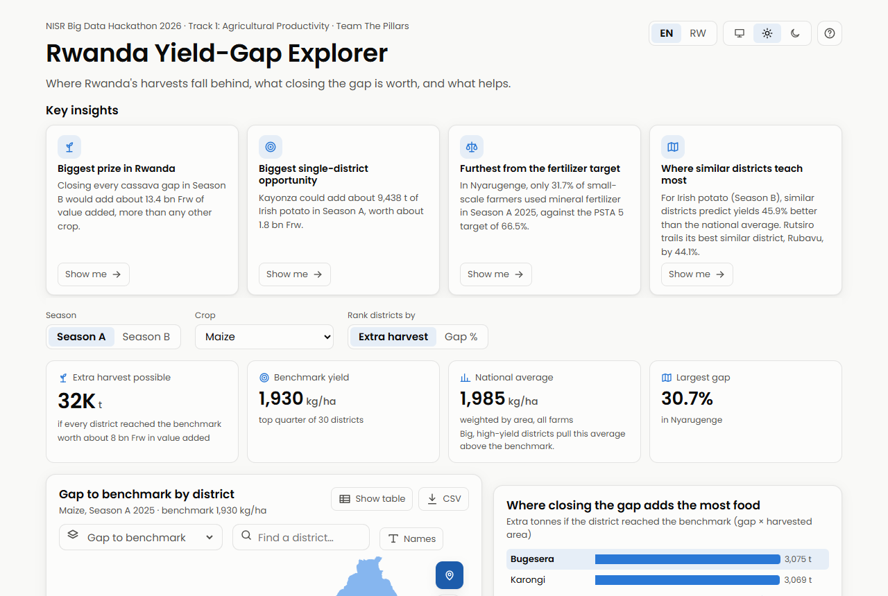
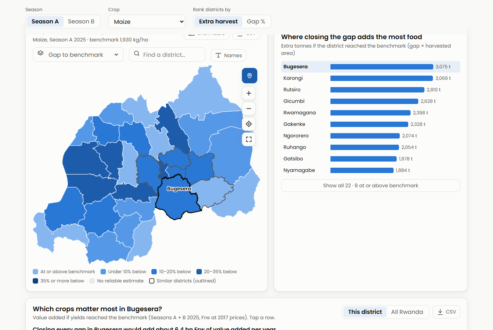
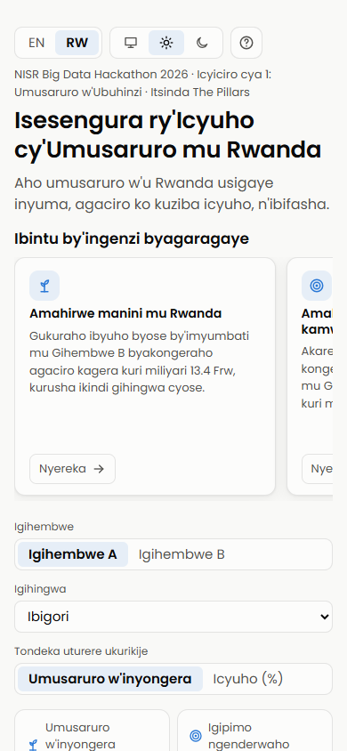

# Rwanda Yield-Gap Explorer

**NISR Big Data Hackathon 2026 · Track 1: Agricultural Productivity · Team The Pillars**

Where Rwanda's harvests fall behind, what closing the gap is worth, and what helps: for 16 crops,
30 districts and both main seasons, built on NISR's Seasonal Agricultural Survey (SAS) 2025.

**[Open the app](https://pazzo123.github.io/yieldgap-rwanda/)** ·
[Project report](docs/project-report.md) · [Methodology](docs/methodology.md) ·
[AI-use disclosure](docs/AI_USE.md)



| Map and district panel | On a phone, in Kinyarwanda |
|---|---|
|  |  |

## The idea

NST2 aims to raise agricultural productivity by 50%, yet yields for the same crop differ widely
between districts. For each district and crop, the app shows how far its yield is below a
**benchmark** (the level the top quarter of districts already reach), how much food and **value in
Frw** closing that gap would add, which farm practices go with higher yields, and which **similar
districts** do better, so support can go where it pays off most.

## What it does

- **Key insights:** four findings computed from the data, each with a "Show me" button.
- **Interactive district map:** shade it by gap, gap to similar districts, yield, extra harvest or
  value; zoom, pinch, drag, search, name labels; hover or tap for details; table view; CSV download.
- **Find my district (📍):** uses the phone's location to open the statistics of the district you
  are in. The position is matched on the device and never sent anywhere.
- **Crop priorities:** every crop and season for a district, or for all of Rwanda, ranked by value
  added (Frw), so different crops can be compared.
- **District panel:** an automatic plain-language summary; yield against the benchmark; practices
  against Rwanda; a **what-if** panel (only strong, positive links that hold within provinces, up
  to the highest level any district reached); **similar districts** from a nearest-neighbour model
  validated by leave-one-out and nested tests; a **PSTA 5 target tracker**.
- **Easy to start:** a 7-step spotlight guide on the first visit (replay with "?"), an icon-first
  design, English and Kinyarwanda, light, dark or automatic theme, share link, printable district
  sheet.
- **Private and light:** no third-party requests (the Poppins font is served from the site), no
  tracking, about 0.6 MB in total.

## Quick start

Python 3.10+ and Node 20+ (Node is only needed for the checks).

```
pip install -r requirements.txt
python src/download_data.py          # the two public inputs (not stored in the repository)
python src/extract_yields.py
python src/extract_inputs.py
python src/crop_values.py
python src/yield_gaps.py
python src/input_links.py
python src/peer_districts.py
python src/build_app_data.py         # writes app/data/*.js
python tests/check_data.py           # consistency of the processed tables
node tests/check_app.js              # app data, text and assets
```

Run the app locally by opening `app/index.html`, or serve the folder (`npx serve app`).
Every push to `main` runs the checks and then publishes `app/` through
[.github/workflows/pages.yml](.github/workflows/pages.yml). That needs a one-time setting on GitHub:
Settings → Pages → Source: **GitHub Actions**.

The page state lives in the URL (for example `#B/Cassava/Rusizi`, or `?lang=rw` for Kinyarwanda),
so any view can be shared.

## Data sources

| Dataset | Use | Access |
|---|---|---|
| Seasonal Agricultural Survey (SAS) 2025, annual tables | Yields, harvested area, input use, practices, crop value added | Public, statistics.gov.rw |
| District boundaries (geoBoundaries RWA ADM2, from Open Data Rwanda / NISR) | App map | Public, CC BY 4.0 |
| MINAGRI PSTA 5 (abridged) | The 50% productivity goal and the 2028/29 input targets | Public PDF |

Raw files are **not** committed; see [data/README.md](data/README.md) and [NOTICE.md](NOTICE.md).

## Repository layout

```
data/raw/        downloaded inputs (git-ignored)
data/processed/  small tidy tables that the app reads (committed)
src/             download, extraction, analysis and app-data scripts
tests/           consistency checks run on every push
app/             the web app (deployed): HTML, CSS, JavaScript, fonts, data
docs/            project report, methodology, AI-use disclosure, screenshots
```

## Competition

| | |
|---|---|
| Organiser | National Institute of Statistics of Rwanda (NISR) |
| Competition page | <https://statistics.gov.rw/about/hackathon/2026-hackathon-competition> |
| Submission form | <https://statistics.gov.rw/form/2026-hackathon-submission-form> |
| **Submission deadline** | **30 October 2026, 11:59 PM** |
| Deliverables | Public GitHub repo, deployed app link, documentation |

Judging (20 points each): problem understanding and NST2/Vision 2050 relevance, data use and
methodology, technical innovation, usability and design, tangible impact.

## Team: The Pillars

- Uwineza Gloria ([@uwinezagloria](https://github.com/uwinezagloria))
- Patrick Straton MBABAZI ([@PAZZO123](https://github.com/PAZZO123))

## AI use and intellectual property

AI tools were used as assistants; the details are in [docs/AI_USE.md](docs/AI_USE.md), as the
competition rules require. By entering the hackathon, the team assigns all intellectual property
rights in this work to NISR.
