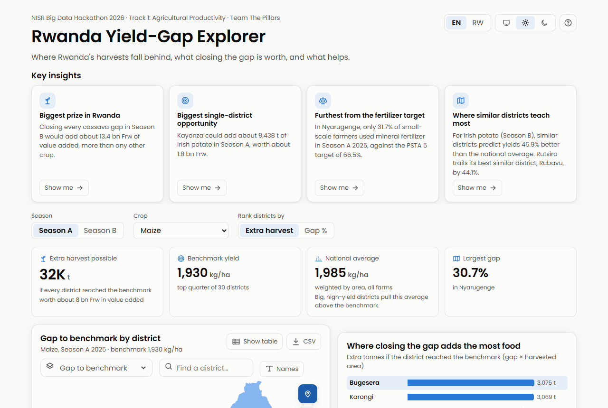
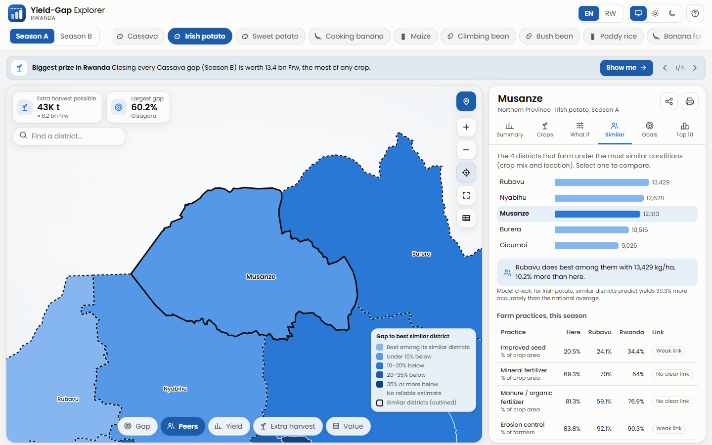
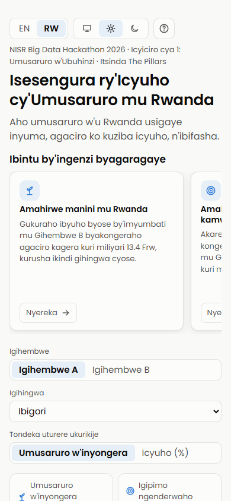

# Rwanda Yield-Gap Explorer

**NISR Big Data Hackathon 2026 · Track 1: Agricultural Productivity · Team The Pillars**

Where Rwanda's harvests fall behind, what closing the gap is worth, and what helps: for 16 crops,
30 districts and both main seasons, built on NISR's Seasonal Agricultural Survey (SAS) 2025.

**[Open the app](https://pazzo123.github.io/yieldgap-rwanda/)** ·
**[Watch the demo](https://pazzo123.github.io/yieldgap-rwanda/demo.mp4)** ·
[Project report](docs/project-report.md) · [Methodology](docs/methodology.md) 




| Zoomed in, similar districts outlined | On a phone, in Kinyarwanda |
|---|---|
|  |  |

## The idea

NST2 aims to raise agricultural productivity by 50%, yet yields for the same crop differ widely
between districts. For each district and crop, the app shows how far its yield is below a
**benchmark** (the level the top quarter of districts already reach), how much food and **value in
Frw** closing that gap would add, which farm practices go with higher yields, and which **similar
districts** do better, so support can go where it pays off most.

## What it does

- **Map first:** the district map fills most of the screen; crops are one-tap chips with icons, the
  season is a two-way switch, and the map colours (gap, similar districts, yield, extra harvest,
  value) are pills under the map. Hover or tap for numbers, scroll, pinch or drag to zoom, double-click
  a district to zoom to it, search, table view and CSV download.
- **One highlight at a time:** four findings computed from the data, each with a "Show me" button
  that opens the view behind it.
- **Find my district (📍):** uses the phone's location to open the statistics of the district you
  are in. The position is matched on the device and never sent anywhere.
- **District panel (six tabs):** *Summary* (four numbers, yield against the benchmark, two hints, an
  automatic plain-language text); *Crops* (every crop and season for the district or for Rwanda,
  ranked by value added in Frw); *Boost yield* (only strong, positive links that hold within provinces,
  up to the highest level any district reached); *Similar* (a nearest-neighbour model validated by
  leave-one-out and nested tests, plus practices against Rwanda); *Goals* (a PSTA 5 target
  tracker); *Top 10* (districts ranked by extra harvest or gap).
- **Easy to start:** no manual needed: a "Tap a district" hint disappears after the first tap, every
  button has an icon and a tooltip, and a 6-step spotlight guide is one tap away on "?". English and
  Kinyarwanda, light, dark or automatic theme, share link, printable district sheet.
- **Private and light:** no third-party requests (the Poppins font is served from the site), no
  tracking, about 0.6 MB in total.

## Quick start

Python 3.10+ and Node 20+ (Node is only needed for the checks).

```
pip install -r requirements.txt
python src/download_data.py          # the two public inputs (not stored in the repository)
python src/extract_yields.py
python src/extract_inputs.py
python src/crop_values.py
python src/national_trends.py        # national figures for every year in the workbook's summary table
python src/yield_gaps.py
python src/input_links.py
python src/peer_districts.py
python src/build_app_data.py         # writes app/data/*.js
python tests/check_data.py           # consistency of the processed tables
node tests/check_app.js              # app data, text and assets
python tests/check_any_year.py       # the pipeline also works on another year's SAS workbook
```

### Using another SAS year

The project uses SAS 2025, the hackathon's dataset, but nothing in the code is tied to that year:

- **Tables are found by their title, not their number.** NISR renumbers its tables between years,
  so `src/sas_tables.py` looks for words such as "average yield by crop" + "Season A". If a table is
  missing or two tables match, the pipeline stops with a clear message instead of reading the wrong one.
- **The year is read from the workbook** ("SAS 2025" on its contents sheet) and stored in
  `data/processed/survey.json`. The app shows that year wherever the text mentions it.
- **One workbook at a time:** the pipeline reads the one `sas*annual*tables*.xlsx` file in
  `data/raw/` (or the file named by the `SAS_FILE` environment variable).

To switch year: put the new "Annual Tables" workbook in `data/raw/` (for example
`python src/download_data.py --sas-url "<link from statistics.gov.rw>"`), remove the old one, and
run the steps above. `tests/check_any_year.py` proves this works: it builds a copy of the 2025
workbook with every table renumbered, the sheets reordered and the year changed, runs the whole
analysis on it and checks that every result is identical.

Run the app locally by opening `app/index.html`, or serve the folder (`npx serve app`).
Every push to `main` runs the checks and then publishes `app/` through
[.github/workflows/pages.yml](.github/workflows/pages.yml). That needs a one-time setting on GitHub:
Settings → Pages → Source: **GitHub Actions**.

The page state lives in the URL (for example `#B/Cassava/Rusizi`, or `?lang=rw` for Kinyarwanda),
so any view can be shared.

## Data sources

| Dataset | Use | Access |
|---|---|---|
| Seasonal Agricultural Survey (SAS) 2025, annual tables | Yields, harvested area, input use, practices, crop value added | Public, statistics.gov.rw |
| District boundaries (geoBoundaries RWA ADM2, from Open Data Rwanda / NISR) | App map | Public, CC BY 4.0 |
| MINAGRI PSTA 5 (abridged) | The 50% productivity goal and the 2028/29 input targets | Public PDF |

Raw files are **not** committed; see [data/README.md](data/README.md) and [NOTICE.md](NOTICE.md).

## Repository layout

```
data/raw/        downloaded inputs (git-ignored)
data/processed/  small tidy tables that the app reads (committed)
src/             download, extraction, analysis and app-data scripts
tests/           consistency checks run on every push
app/             the web app (deployed): HTML, CSS, JavaScript, fonts, data
docs/            project report, methodology, AI-use disclosure, screenshots
```

## Competition

| | |
|---|---|
| Organiser | National Institute of Statistics of Rwanda (NISR) |
| Competition page | <https://statistics.gov.rw/about/hackathon/2026-hackathon-competition> |
| Submission form | <https://statistics.gov.rw/form/2026-hackathon-submission-form> |
| **Submission deadline** | **30 October 2026, 11:59 PM** |
| Deliverables | Public GitHub repo, deployed app link, documentation |

Judging (20 points each): problem understanding and NST2/Vision 2050 relevance, data use and
methodology, technical innovation, usability and design, tangible impact.

## Team: The Pillars

- Uwineza Gloria ([@uwinezagloria](https://github.com/uwinezagloria))
- Patrick Straton MBABAZI ([@PAZZO123](https://github.com/PAZZO123))

## AI use and intellectual property

AI tools were used as assistants; the details are in [docs/AI_USE.md](docs/AI_USE.md), as the
competition rules require. By entering the hackathon, the team assigns all intellectual property
rights in this work to NISR.
